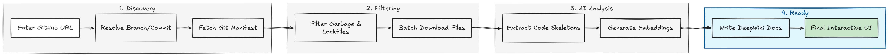
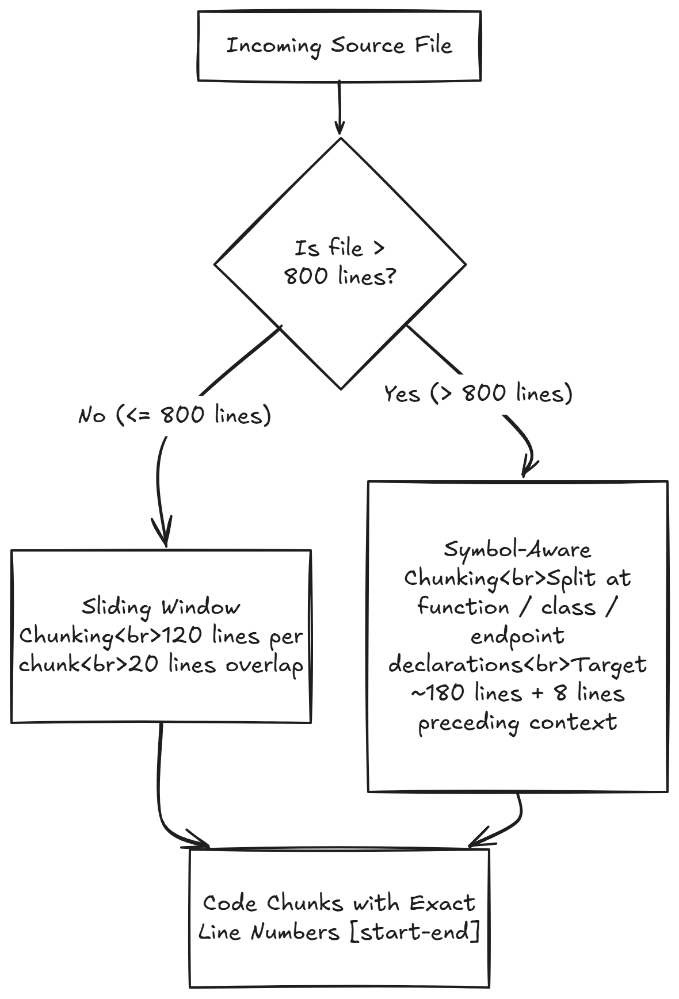
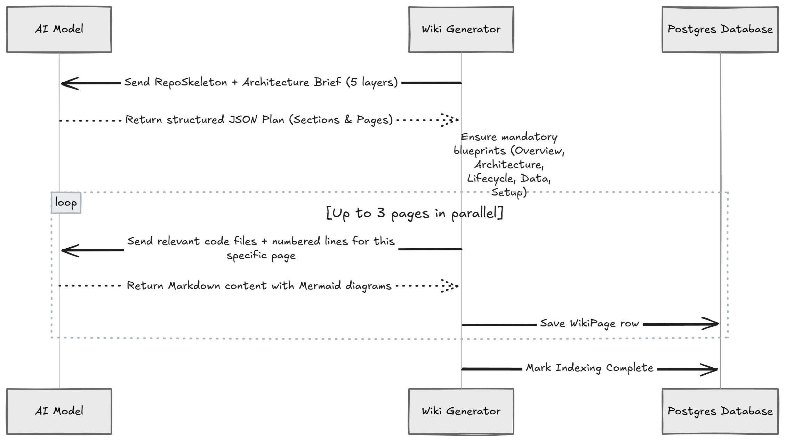
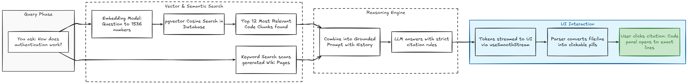

# How RepoSense Works: Under the Hood

This guide explains in plain English what actually happens when you paste a GitHub repository URL into RepoSense, how documentation is generated, how code search finds answers, and why things were built this way.

---

## 1. What Happens When You Give a GitHub URL?

When you paste a URL like `https://github.com/facebook/react` and click **Index**, the app does not run `git clone`. Cloning an entire repository onto a server takes too much disk space and memory, and downloading gigabytes of commit history is unnecessary.

Instead, RepoSense talks to GitHub's REST API and processes everything in memory through a step-by-step pipeline.



### Step 1: Resolving the target
Before downloading anything, RepoSense resolves your branch name (e.g., `main`, `dev`, or pull request number) to an exact Git commit SHA. This ensures that every file downloaded belongs to the exact same revision.

### Step 2: Grabbing the entire file list without downloading contents
GitHub has a tree API endpoint: `/repos/{owner}/{repo}/git/trees/{sha}?recursive=1`.
In a single lightweight HTTP request, GitHub returns a list of every file path, size, and type in the repository.

### Step 3: Filtering out the junk
Most files in a repository do not help explain how the code works. If we embedded everything, we would waste money on AI tokens and clutter search results.
The filter removes:
- Dependencies and build artifacts: `node_modules/`, `.git/`, `.next/`, `dist/`, `build/`, `coverage/`, `__pycache__/`.
- Lockfiles: `package-lock.json`, `pnpm-lock.yaml`, `yarn.lock`, `Cargo.lock`. These are huge lists of URLs and checksums, not human logic.
- Media and binaries: PNGs, JPGs, fonts, PDFs, compiled `.exe` or `.wasm` files.
- Secret files: `.env` and private keys.
- Giant files: Any single file larger than 250 KB is skipped to protect server memory.
- Monorepo guard: If the repository has more than 10,000 files or 64 MB of text, RepoSense stops early with a clear warning.

### Step 4: Batch downloading
The remaining files are downloaded in batches of up to 20 files or 800 KB at a time. This prevents hitting GitHub's rate limits and avoids connection timeouts.

---

## 2. How Chunking Works: Cutting Code into Understandable Pieces

AI embedding models cannot read a 3,000-line file all at once. If you stuff an entire file into an embedding, the meaning gets diluted and search precision drops. You need chunks.

RepoSense uses two chunking strategies depending on how big the file is.



### Strategy A: Sliding window (for standard files under 800 lines)
- **Chunk size:** 120 lines.
- **Overlap:** 20 lines.
- Why overlap? If a crucial function starts on line 115 and ends on line 130, cutting strictly at line 120 would slice it in half. The 20-line overlap ensures that the boundary area is present in both chunks so context is never lost.

### Strategy B: Symbol-aware boundary chunking (for giant files over 800 lines)
In large controller or service files, cutting every 120 lines arbitrarily breaks functions mid-loop.
- RepoSense scans the file with regex for function declarations, class definitions, and API route declarations (like `app.get`, `def `, `async fn`).
- It cuts at these natural boundaries, aiming for roughly 180 lines per chunk.
- It also grabs the 8 lines right before the function. This captures decorators, docstrings, or TypeScript types that describe what the function does.

### The Secret Weapon: RepoSkeleton & Structural Analysis
While chunking files, RepoSense builds a lightweight, high-density structural map called the **RepoSkeleton** (`src/lib/chunker.ts`).

Instead of feeding hundreds of thousands of raw lines to an LLM to figure out project architecture, the skeleton extracts the core interface surface of every eligible code file:

#### 1. What does the RepoSkeleton data structure actually look like?
```typescript
export interface RepoSkeletonEntry {
  filePath: string;                  // e.g. "src/server/routes/projects.ts"
  directory: string;                 // e.g. "src/server/routes"
  lineCount: number;                 // e.g. 542
  sizeBytes: number;                 // e.g. 18240
  imports: Array<{
    statement: string;               // e.g. "import { db } from '~/server/db';"
    line: number;                    // Line number in original file
  }>;
  exports: Array<{
    signature: string;               // e.g. "export const projectsRoutes = new Hono()..."
    line: number;                    // Line number where declaration starts
  }>;
}

export interface RepoSkeleton {
  generatedAt: string;               // ISO Timestamp
  fileCount: number;                 // Total files analyzed
  directories: string[];             // Unique sorted directory list
  files: RepoSkeletonEntry[];        // Per-file breakdown
}
```

#### 2. How are imports and exports extracted without heavy AST parsers?
Running multi-language AST parsers (like Tree-sitter or Babel) in serverless environments (Cloudflare Workers/Edge) incurs heavy cold starts and native binary dependencies. RepoSense uses high-speed, targeted regex pattern engines:
- **Imports:** Detects ES Modules (`import ... from`), CommonJS (`require(...)`), Python (`from ... import`, `import ...`), and Rust (`use ...;`). Capped at 60 imports per file to prevent prompt flooding.
- **Exports:** Captures exported functions, classes, interfaces, TypeScript types, Go funcs, Rust `pub fn`, Python top-level `def`, and HTTP routes (`app.get`, `router.post`). Capped at 120 exports per file.
- **Symbol context extraction:** For symbol-aware chunks, RepoSense grabs 8 preceding lines (`SYMBOL_CONTEXT_LINES = 8`) to preserve decorators (`@Injectable()`, `@Component`), JSDoc/docstrings, and type annotations that explain the declaration.

#### 3. How does the Skeleton turn into the Architecture Brief?
In `src/lib/wiki/analyzer.ts`, the skeleton is paired with parsed package manifests (`package.json`, `Cargo.toml`, etc.) to automatically classify every file into one of 5 architectural tiers:
1. `entry`: Bootstrapping & routing (`src/app/layout.tsx`, `src/server/app.ts`, `main.ts`).
2. `core`: Domain logic and processing services (`src/lib/indexing-workflow.ts`, `src/lib/qa-engine.ts`).
3. `integrations`: Third-party APIs & SDKs (Clerk, GitHub Octokit, Vercel AI SDK, Cloudinary).
4. `data`: Database schema, migrations, vector storage (`prisma/schema.prisma`, `src/server/db.ts`).
5. `utilities`: Shared helpers, formatters, and crypto (`src/lib/utils.ts`, `src/lib/providers/crypto.ts`).

This brief compresses a 50,000-line codebase down to ~3,000 tokens of dense architectural context, giving the documentation planner complete topological awareness of the system.

---

## 3. How Documentation (DeepWiki) is Created

Instead of asking an AI to "write docs for this repo" in one huge prompt (which causes hallucination, truncation, and shallow summaries), RepoSense splits documentation into a two-phase process: **Plan first, write second**.



### Phase 1: Planning
The model receives the **RepoSkeleton** and an **Architecture Brief** that classifies files into five categories:
1. `entry`: How the app boots (main.ts, index.js, app router).
2. `core`: Business logic, services, domain algorithms.
3. `integrations`: Third-party APIs, Stripe, webhooks, auth providers.
4. `data`: Database models, Prisma schemas, migrations.
5. `utilities`: Helper functions, string formatters, validators.

The model responds with a clean JSON outline detailing what sections and pages are needed. RepoSense also enforces a mandatory safety net of blueprint pages:
- System Overview
- System Architecture
- Runtime Execution and Lifecycle
- Data Flow and Storage
- Setup and Developer Tooling

### Phase 2: Page writing in parallel
Once the outline is approved:
- RepoSense picks up each page one by one.
- It finds only the files relevant to that page and numbers their lines (`1 | import ...`).
- It generates the pages concurrently, capped at 3 at a time so we do not exceed API rate limits.
- The prompt demands clear explanations and Mermaid diagrams for architecture flows.

---

## 4. What Happens When You Ask a Question?

When you ask: *"How does authentication work in this repo?"*, here is the journey of that question:



### 1. Vector conversion
Your question is converted into a vector (a list of 1,536 numbers representing semantic meaning). Words like "auth", "login", "jwt", and "session" all point to similar regions in vector space.

### 2. Finding the needles in the haystack
PostgreSQL uses the pgvector extension and the cosine distance operator (`<=>`) to find the 12 code chunks whose vector numbers are mathematically closest to your question.
Importantly, this search is filtered by your project ID and branch so data from other repos or branches is never mixed in.

### 3. Adding wiki context
At the same time, RepoSense scans the generated wiki pages for matching keywords to give the model high-level architectural understanding alongside the raw code snippets.

### 4. Grounding and citation enforcement
The model receives the system instructions:
- Answer only using the supplied code and wiki context.
- If the code does not show how something works, say so directly. Do not make up APIs.
- Every technical fact must cite its source in the format: `[[path/to/file.ts:startLine-endLine]]`.

### 5. Interactive UI pills
When the streamed answer arrives in the browser:
- The custom Markdown parser detects `[[src/auth.ts:15-32]]`.
- It replaces the raw brackets with an interactive, clickable badge.
- Clicking the badge opens the file in a full-width code panel, automatically scrolling and highlighting lines 15 to 32.

---

## 5. How Do We Ensure High Quality?

Bad AI systems hallucinate, skip edge cases, or produce blurry summaries. RepoSense uses multiple guardrails:

| Challenge | What Goes Wrong | How RepoSense Fixes It |
|---|---|---|
| Hallucinated code | Model invents functions that do not exist | Grounding prompt: The model is penalized unless it cites exact line numbers present in the retrieved chunks. |
| Cut-off code logic | Chunks split a critical function in half | Overlap window of 20 lines for standard files, plus symbol-aware declaration splitting for files > 800 lines. |
| Incomplete wiki | Model forgets to write setup or schema docs | Blueprint enforcement: Core architectural pages are automatically injected even if the model plan forgot them. |
| Broken diagrams | Model writes bad Mermaid syntax that crashes the page | The frontend sanitizes raw Mermaid syntax before rendering and catches errors cleanly without crashing the UI. |
| Jumpy, stuttering streaming | Fast AI streams cause browser layout thrashing | Custom `useSmoothStream` hook uses `requestAnimationFrame` to buffer tokens and render at a clean 60 FPS. |
| Stale answers | Switching branches shows answers from old commits | All vectors, wiki pages, and chat sessions are strictly scoped by `(projectId, branch)`. |

---

## 6. What Other Approaches Could We Have Taken?

| Alternative Approach | What It Is | Why We Did Not Choose It | What Was Gained / Lost |
|---|---|---|---|
| **Git Clone on the Server** | Running `git clone --depth 1` onto disk | Serverless environments (like Vercel or Cloudflare) do not have persistent disks or Git CLI binaries. | Gained: Works in any serverless runtime. Lost: Cannot inspect Git history older than the current commit. |
| **Tree-sitter Full AST Parsers** | Compiling real language grammars to parse syntax trees | Requires compiling native C/WASM binaries for 30 different languages. Heavy memory usage and slow cold starts. | Gained: Fast, zero-dependency deployment. Lost: Regex misses complex nested macros or weird language syntax. |
| **Dedicated Vector DB (Pinecone / Qdrant)** | Storing vectors in an external cloud database | Increases infrastructure cost, adds a second system to synchronize, and makes project deletion messy. | Gained: Everything lives in PostgreSQL. Deleting a project cascades and deletes all vectors in one transaction. Lost: Slightly slower than in-memory Redis at massive scale (> 10M vectors). |
| **Single Huge LLM Prompt** | Stuffing the whole repo into a 1M token context window (e.g. Gemini 1.5 Pro) | Extremely expensive per query, slow response times, and prone to "lost in the middle" retrieval failures. | Gained: Cheap, fast, repeatable queries. Lost: The model does not see 100% of the raw codebase simultaneously. |

---

## 7. What Improvements Could We Make in the Future?

1. **Incremental Git diff indexing:**
   When you push 2 modified files to GitHub, RepoSense should not re-index the whole repository. It should call GitHub's Compare API, delete vectors for the 2 old files, and re-embed only the updated lines.
2. **True code-graph cross-referencing:**
   Link import statements directly to target file definitions. Clicking a function name in the code viewer could take you straight to where it is defined in another file.
3. **Background job queues (Inngest / BullMQ):**
   For giant repositories with 5,000 files, serverless HTTP functions can time out. Moving ingestion to a durable background queue with automatic retries would make indexing bulletproof.
4. **Local model execution (Ollama / WebLLM):**
   Allow privacy-conscious teams to run embeddings and queries completely offline on their own machines without sending code to any cloud API.
