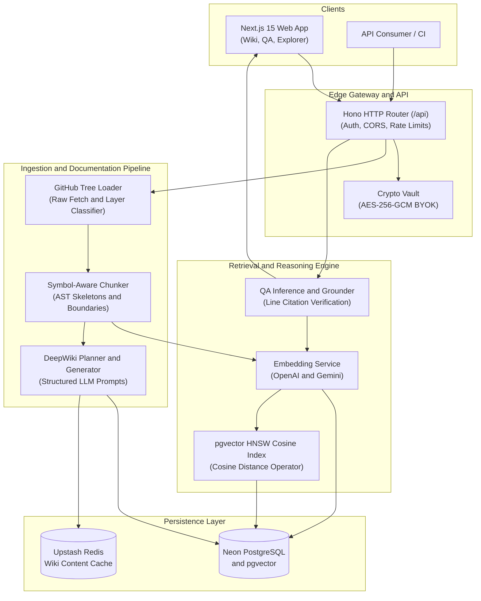
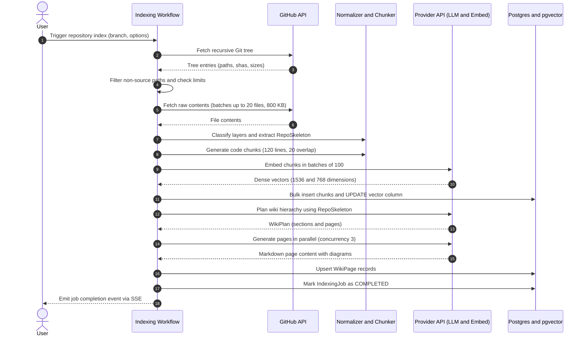
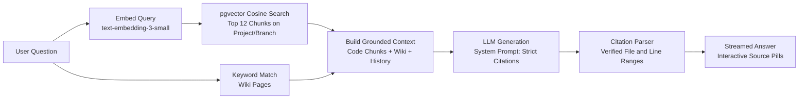
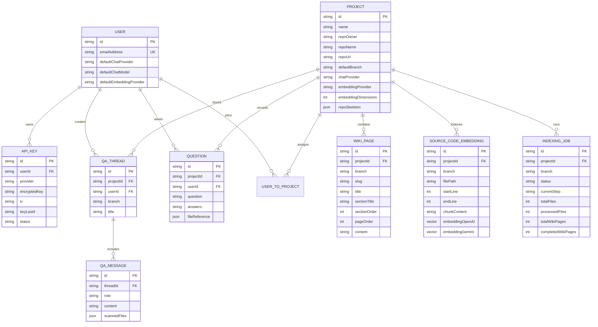

# RepoSense system design

RepoSense is an open source repository intelligence platform. It analyzes Git repositories, extracts structural code skeletons, generates multi-page technical wikis (DeepWiki), and answers codebase queries using vector search with line-level source code citations.

## 1. Goals and non-goals

### Goals
- Ingest public and private GitHub repositories across branches, tags, and pull requests.
- Parse source trees up to 10,000 files and 64 MB total content without full language server protocol (LSP) overhead.
- Segment source code into semantic, symbol-aware chunks with line offset tracking.
- Generate hierarchical, multi-page technical documentation organized by architectural layers.
- Answer developer questions over indexed branches using cosine similarity search on pgvector.
- Return verifiable source citations in the strict format `[[filePath:startLine-endLine]]` with interactive source previews.
- Support Bring Your Own Key (BYOK) for seven model providers (OpenAI, Anthropic, Gemini, Groq, DeepSeek, Meta, and xAI) using authenticated AES-256-GCM encryption.

### Non-goals
- Full semantic compilation or dynamic runtime execution of analyzed repositories.
- In-browser code editing or write-back pull request creation.
- Real-time continuous file system watching on local client machines.
- Persistent storage of raw source trees for long-term code hosting.

## 2. Requirements

### Functional requirements
1. Ingestion: Accept any public or token-authenticated private GitHub URL. Resolve branches, commit SHAs, and pull request references.
2. Filtering and normalization: Exclude non-source files, binaries, build directories, and lockfiles. Classify remaining files into five architectural layers: entry points, core logic, external integrations, data models, and utilities.
3. Chunking: Chunk standard files using sliding windows. For files exceeding 800 lines, chunk along class, function, or endpoint declaration boundaries.
4. Vector indexing: Generate dense vector embeddings using OpenAI (`text-embedding-3-small`, 1536 dimensions) or Google Gemini (`text-embedding-004`, 768 dimensions). Store vectors in PostgreSQL using the pgvector extension.
5. Wiki generation: Plan a multi-page documentation hierarchy and generate markdown content in parallel with bounded worker concurrency.
6. Grounding and citations: Retrieve relevant source chunks and wiki pages for user questions. Produce markdown answers where every technical statement references exact file paths and line ranges.
7. Branch isolation: Partition all embeddings, wiki pages, and chat sessions by `(projectId, branch)`. Allow users to switch between branches or pull requests without re-indexing common roots.

### Non-functional requirements
- Availability: 99.9% uptime for read endpoints (wiki navigation and public repository exploration).
- Retrieval latency: Less than 300 milliseconds for vector similarity search across 50,000 code chunks.
- Answer streaming: First token latency under 1.5 seconds for streamed question answers.
- Job durability: Repository indexing jobs run asynchronously with step-level progress tracking. Uncaught worker exceptions mark jobs as failed with actionable error codes.
- Security: Zero plaintext storage of user API keys and GitHub personal access tokens. All credentials encrypt with AES-256-GCM and random 12-byte initialization vectors.

## 3. Scale and capacity estimation

The system targets small to mid-sized engineering teams and open source communities.

### Traffic parameters

| Parameter | Value | Notes |
|---|---|---|
| Monthly indexed repositories | 5,000 repos | Ingestion workload |
| Average files per repository | 650 source files | After ignore filters and size checks |
| Average chunks per file | 8 chunks | 120 lines per chunk with 20-line overlap |
| Total chunks per repository | 5,200 chunks | 650 files * 8 chunks |
| Monthly new code chunks | 26,000,000 chunks | 5,000 repos * 5,200 chunks |
| Daily question volume | 40,000 queries | ~1.2M queries per month |
| Peak question throughput | 120 queries/second | Peak factor 2.6 over 12 daytime hours |

### Working math

Write throughput (Indexing):
- 5,000 repositories / 30 days = 167 repositories/day.
- Average sustained ingestion: ~0.002 repos/sec, with peak burst capacity of 10 concurrent repository indexing jobs.
- Peak chunk embedding generation: 10 jobs * (5,200 chunks / 180 seconds average job runtime) = 288 chunks/sec sent to embedding providers.

Read throughput (Vector search and QA):
- 40,000 queries/day / 43,200 active seconds = 0.93 queries/sec average.
- Peak multiplier 2.6x yields ~2.5 QPS sustained, with marketing spikes up to 120 QPS.
- Each query generates one query embedding (1 API call) and runs one pgvector query retrieving top 12 chunks.

### Storage and memory sizing

Raw chunk storage:
- Average chunk size: 450 bytes text.
- Metadata per chunk (file path, line numbers, commit SHA, foreign keys): ~250 bytes.
- Total text row size: 700 bytes.
- 5,200 chunks * 700 bytes = 3.64 MB per repository.

Vector storage (pgvector):
- OpenAI vector: 1,536 dimensions * 4 bytes (float4) = 6,144 bytes per chunk.
- Gemini vector: 768 dimensions * 4 bytes (float4) = 3,072 bytes per chunk.
- With OpenAI default: 5,200 chunks * 6.14 KB = 31.95 MB vector data per repository.
- Total storage per repository: 3.64 MB text + 31.95 MB vectors = 35.59 MB.
- Monthly database storage growth: 5,000 repos * 35.6 MB = 178 GB/month.

Index memory sizing (HNSW on PostgreSQL):
- HNSW graph overhead: ~1.25 * vector size.
- 1,536 dimensions vector with graph: ~7.7 KB per row.
- 500,000 active chunks in hot cache: 500,000 * 7.7 KB = 3.85 GB RAM required in PostgreSQL `shared_buffers` and OS page cache for sub-50ms vector lookups.

## 4. High-level design

RepoSense uses a decoupled architecture. The frontend runs on Next.js 15 with React Server Components and client-side streaming hooks. The backend API runs on Hono, mounted at `/api`, providing high-throughput routing, token validation, and Server-Sent Events (SSE). Persistent state and vector storage reside in Neon Serverless PostgreSQL with the pgvector extension.



### Component roles
- Hono API router: Validates session tokens from Clerk, unpacks route parameters, checks project authorization, and streams responses.
- Crypto vault: Manages user-supplied API keys and private repository GitHub personal access tokens. Encrypts plaintext keys with AES-256-GCM before writing to the database.
- GitHub tree loader: Fetches recursive Git trees, applies file-exclusion filters, batches raw file downloads within rate limits, and extracts manifest structures.
- Symbol-aware chunker: Scans code for top-level declarations, computes line offsets, and extracts import and export statements into a light structural skeleton.
- DeepWiki planner and generator: Produces a multi-section documentation outline based on repository architecture, then parallelizes individual page generation with concurrency controls.
- Vector search and QA service: Embeds incoming questions, executes cosine similarity queries on PostgreSQL, builds prompt contexts, and streams answers with verified line-level citations.

## 5. Low-level design

### File filter and normalizer
The ingestion pipeline discards non-informative content before spending compute or token budgets. The filter checks file paths against fixed exclusion lists:
- Directories: `node_modules/`, `.git/`, `.next/`, `dist/`, `build/`, `coverage/`, `__pycache__/`, `.venv/`.
- Lockfiles: `package-lock.json`, `pnpm-lock.yaml`, `yarn.lock`, `Cargo.lock`, `poetry.lock`.
- Binary and media extensions: images, fonts, archives, videos, compiled objects, and sourcemaps.
- Thresholds: Individual files larger than 250 KB are skipped. Repositories exceeding 10,000 files or 64 MB total source content trigger an early cutoff.

The repository normalizer analyzes surviving files and assigns them to five architectural layers:
1. `entry`: Root launch scripts, Next.js page routers, Express `app.listen`, or `main.go`.
2. `core`: Business domain logic, services, state machines, and core algorithms.
3. `integrations`: Third-party SDK wrappers, webhook listeners, payment adapters, and email handlers.
4. `data`: Database schemas, Prisma models, migrations, and ORM entity definitions.
5. `utilities`: Shared helper routines, formatting functions, and validation schemas.

### Chunking and skeleton extraction
Code chunking operates in two modes depending on file length:

1. Standard sliding window: Files up to 800 lines split into blocks of 120 lines (`CHUNK_LINES`) with a 20-line overlap (`CHUNK_OVERLAP`).
2. Symbol-aware boundary chunking: For files longer than 800 lines, regular expression heuristics detect top-level function, class, and route definitions. The chunker splits at declaration lines, targeting 180 lines per block (`SYMBOL_CHUNK_LINES`) with 8 lines of preceding context (`SYMBOL_CONTEXT_LINES`).

During chunking, the system generates a `RepoSkeleton`. The skeleton records file paths, line counts, byte sizes, import statements, and exported symbol signatures. This skeleton fits within LLM context windows, allowing documentation planners to reason about whole-repo architecture without loading thousands of raw source lines.



### DeepWiki documentation generator
Documentation generation runs in two distinct phases:

1. Planning phase: The LLM receives the `RepoSkeleton` and a structured architecture brief. It produces a JSON `WikiPlan` containing ordered sections and individual page specifications. The system guarantees mandatory foundational pages:
   - System Overview
   - System Architecture
   - Runtime Execution and Request Lifecycle
   - Data Flow and Storage
   - Setup, Scripts, and Developer Workflow
2. Page generation phase: Pages generate concurrently with a maximum concurrency limit of 3 (`PAGE_CONCURRENCY = 3`). For each page, the generator injects relevant source skeletons and line-numbered file excerpts. The system instructs the model to construct Markdown containing Mermaid diagrams, state transitions, and file references.

### Retrieval augmented generation (RAG) and citations
The QA engine uses a multi-stage retrieval and answer generation pipeline:



1. Question embedding: The user query converts to a dense vector using the project's configured embedding provider.
2. Chunk retrieval: A raw SQL query runs against PostgreSQL using the pgvector cosine distance operator:
   ```sql
   SELECT "id", "filePath", "directory", "startLine", "endLine", "chunkContent",
          1 - ("embeddingOpenAI" <=> $1::vector) AS similarity
   FROM "SourceCodeEmbedding"
   WHERE "projectId" = $2
     AND "branch" = $3
     AND "embeddingOpenAI" IS NOT NULL
   ORDER BY "embeddingOpenAI" <=> $1::vector
   LIMIT 12;
   ```
3. Context assembly: The top 12 code chunks combine with matched wiki pages and recent conversation history. Each chunk header includes file path, line numbers, and similarity score.
4. Citation enforcement: The system prompt instructs the model to answer exclusively from the context and append inline citations in the format `[[filePath:startLine-endLine]]`.
5. Interactive rendering: The frontend Markdown parser transforms bracketed citation strings into interactive pills. Clicking a pill loads the referenced source file into a stacked code panel, highlights the exact line range, and links directly to the repository on GitHub.

## 6. Data models and database schema

The persistence layer runs on PostgreSQL with the pgvector extension. Relational tables capture repository configuration, encrypted provider credentials, multi-page wiki hierarchies, branch-scoped embeddings, and indexing state machines.



### Core table summary

| Table | Primary key | Scoping and foreign keys | Storage notes |
|---|---|---|---|
| `Project` | `id` | Indexed on `(repoOwner, repoName, isPublicWiki)` | Holds project settings, default models, and the compact `repoSkeleton` JSON. |
| `WikiPage` | `id` | Unique `(projectId, branch, slug)` | Stores generated markdown content, section groupings, and navigation order. |
| `SourceCodeEmbedding` | `id` | Indexed on `(projectId, branch, filePath)` | Holds chunk lines and dual vector columns (`vector(1536)` for OpenAI and `vector(768)` for Gemini). |
| `IndexingJob` | `id` | Foreign key to `Project` | State machine tracking progress across file loading, chunking, planning, and page generation. |
| `ApiKey` | `id` | Unique `(userId, provider)` | AES-256-GCM encrypted provider credentials with separate 12-byte initialization vectors. |
| `QaThread` / `QaMessage` | `id` | Scoped to `(projectId, branch, userId)` | Multi-turn chat sessions with recorded line citations and model metadata. |

## 7. API design

The Hono application serves all endpoints under `/api`. Protected routes require a valid Clerk bearer token or session cookie.

### Start repository indexing
```http
POST /api/projects/:id/indexing/start
Content-Type: application/json

{
  "branch": "main",
  "branchKind": "MAIN",
  "pullRequestNumber": null
}
```

Response (200 OK):
```json
{
  "jobId": "cly10x89a000108l43b4z1b4d",
  "projectId": "clw09x11a000208l48b4z0a1e",
  "status": "QUEUED",
  "branch": "main"
}
```

### Stream indexing progress (Server-Sent Events)
```http
GET /api/projects/:id/indexing/stream?jobId=cly10x89a000108l43b4z1b4d
Accept: text/event-stream
```

Stream events:
```text
event: progress
data: {"step":"CHUNKING_AND_EMBEDDING","processedFiles":140,"totalFiles":320,"percent":43}

event: progress
data: {"step":"GENERATING_PAGES","completedWikiPages":3,"totalWikiPages":7,"percent":75}

event: done
data: {"status":"COMPLETED","totalWikiPages":7,"totalChunks":2480}
```

### Question answering query
```http
POST /api/projects/:id/qa
Content-Type: application/json

{
  "question": "How does the cryptographic key vault encrypt user API tokens?",
  "branch": "main",
  "threadId": "thr_01j7x8a92m"
}
```

Response (200 OK):
```json
{
  "threadId": "thr_01j7x8a92m",
  "answer": "The key vault uses Web Crypto AES-256-GCM [[src/lib/providers/crypto.ts:130-155]]. It generates a random 12-byte initialization vector [[src/lib/providers/crypto.ts:138-140]] and derives a 256-bit CryptoKey via SHA-256 if the input secret is not already 64 hex characters [[src/lib/providers/crypto.ts:60-78]].",
  "modelUsed": "gpt-4o-mini",
  "scannedFiles": [
    {
      "filePath": "src/lib/providers/crypto.ts",
      "startLine": 130,
      "endLine": 155
    }
  ]
}
```

### Public repository wiki lookup
```http
GET /api/public/:owner/:repo/wiki?branch=main
```

Response (200 OK):
```json
{
  "project": {
    "name": "reposense",
    "owner": "Ethan4582",
    "repo": "RepoSense",
    "defaultBranch": "main"
  },
  "sections": [
    {
      "sectionTitle": "Repository Runtime",
      "sectionOrder": 0,
      "pages": [
        { "slug": "overview", "title": "TypeScript System Overview", "pageOrder": 0 },
        { "slug": "architecture", "title": "System Architecture", "pageOrder": 1 }
      ]
    }
  ]
}
```

## 8. Key architectural decisions

### Dual typed vector columns over a generic JSON vector table
- Decision: Define explicit `embeddingOpenAI Unsupported("vector(1536)")` and `embeddingGemini Unsupported("vector(768)")` columns on the `SourceCodeEmbedding` table instead of an untyped JSON array or a generic dimensions table.
- Trade-off gained: Native PostgreSQL HNSW indexing works only with fixed-dimension vector types. Queries execute with index acceleration in sub-25ms instead of full table scans.
- Trade-off lost: Adding a new vector model provider with different dimensions requires a database schema migration and an added nullable column.

### Lightweight regex AST skeletons over full Tree-sitter bindings
- Decision: Extract import paths, exported function signatures, and class headers using regular expression heuristics rather than compiling Tree-sitter WebAssembly modules for 30 different languages.
- Trade-off gained: Zero native binary dependencies, sub-second parsing speed across hundreds of files, zero memory allocation spikes, and full compatibility with serverless runtimes.
- Trade-off lost: Misses complex nested macro expansions and non-standard syntax patterns in exotic languages.

### Client-side Bring Your Own Key (BYOK) with encrypted server vault
- Decision: Allow users to supply personal API keys for OpenAI, Gemini, Anthropic, and Groq, storing them encrypted with server-side AES-256-GCM keys.
- Trade-off gained: Eliminates centralized token billing risks, isolates API quota limits per user, and lets users pick frontier models on demand.
- Trade-off lost: Indexing and QA jobs fail immediately if a user enters an expired or unfunded API key. Mitigation: The UI verifies key connectivity before launching heavy operations.

### Branch-aware composite primary keys
- Decision: Index embeddings and wiki pages using composite scopes `(projectId, branch, slug)` and `(projectId, branch, filePath)`.
- Trade-off gained: Developers can inspect different branches or pull requests simultaneously. Comparing a feature branch to `main` does not overwrite the baseline wiki.
- Trade-off lost: Storing multiple branches of the same repository multiplies database row counts. Mitigation: Indexing defaults to the default branch; auxiliary branches index only on demand.

## 9. Reliability and failure handling

| Component | Failure mode | Detection | Mitigation |
|---|---|---|---|
| GitHub Tree Loader | Primary rate limit exceeded (403/429) | HTTP status code and rate limit headers | Catch `GitHubAccessError`. If user provided a personal token, retry with exponential backoff. Otherwise prompt user to connect a GitHub token. |
| Ingestion Worker | Process eviction or timeout mid-indexing | Job status stuck in `RUNNING` for over 15 minutes | Health check sweep identifies stale jobs, transitions status to `FAILED`, and records `WORKER_TIMEOUT`. Next trigger resumes from last recorded step. |
| Vector Embedder | Provider rate limit or quota exhaustion | `ProviderAccessError` during `embedMany` | Batch requests into smaller chunks (50 items), apply retry with jitter up to 3 attempts, mark key as `QUOTA_EXHAUSTED` on hard 429. |
| Wiki Generator | Model JSON formatting failure during plan generation | `JSON.parse` failure on LLM response string | Fallback heuristic plan generator builds deterministic pages directly from categorized architectural layers. |
| PostgreSQL Database | Connection pool starvation under peak QA load | Prisma connection timeout errors | Configure PgBouncer transaction pooling in Neon; cap max client connections in serverless container configurations. |

## 10. Alternatives and trade-offs

### Standalone Redis vector search vs PostgreSQL pgvector
We evaluated hosting a standalone Redis cluster with RediSearch for vector similarity queries versus using pgvector in our primary PostgreSQL instance.
- Redis pros: Lower search latency (under 5ms) and in-memory indexing.
- Redis cons: Requires maintaining a separate database cluster, synchronizing primary keys across two systems, and paying for high RAM capacity.
- Why pgvector won: Keeping metadata, relational project records, wiki pages, and embeddings in PostgreSQL guarantees transactional consistency. When a user deletes a project or branch, a single cascading foreign key deletion cleans up all related records instantly.

### Full repository git clone vs GitHub REST Tree API
We evaluated running `git clone --depth 1` into temporary worker volumes versus fetching tree manifests and raw files over GitHub REST APIs.
- Git clone pros: Standard Git toolchain support and native file system traversal.
- Git clone cons: Requires container environments with disk access and Git binaries. Cloudflare Workers and serverless Vercel functions cannot run arbitrary shell commands or store multi-gigabyte repositories.
- Why REST Tree won: The REST API runs in lightweight serverless runtimes, downloads only non-ignored source files, and avoids cloning large Git commit histories.

## 11. Future improvements

1. Incremental commit indexing: Compute Git diffs between the previous indexed commit SHA and the current HEAD. Re-chunk and re-embed only modified files, leaving unchanged vector rows intact.
2. Abstract syntax tree (AST) code graph resolution: Resolve imported symbol definitions to exact target declaration files for cross-file jump navigation in the QA panel.
3. Local embedding support: Provide a self-hosted ONNX / Transformers.js worker embedding pipeline for environments that prohibit outbound calls to cloud LLM providers.
4. Automated documentation drift detection: A scheduled GitHub Action that checks whether commits pushed to `main` invalidate existing DeepWiki section content and alerts maintainers.

## 12. Diagram prompts

### Ingestion write path diagram prompt
> Draw a clean left-to-right architecture diagram in Excalidraw style with a white background and dark line borders.
>
> Components (left to right):
> 1. GitHub API: emits tree entries and raw files.
> 2. File Filter & Normalizer: drops lockfiles/binaries and assigns files to 5 architecture layers.
> 3. Symbol Chunker: extracts RepoSkeleton and cuts 120-line chunks.
> 4. Embedding Service: calls OpenAI/Gemini in batches of 100.
> 5. Wiki Generator: creates WikiPlan and parallelizes Markdown page creation.
> 6. Neon PostgreSQL: stores WikiPage rows and pgvector embeddings.
>
> Emphasize the RepoSkeleton as the structural bridge connecting the Chunker to the Wiki Generator.

### QA read path diagram prompt
> Draw a clean top-to-bottom diagram in Excalidraw style with a white background and rounded boxes.
>
> Flow:
> 1. User enters question in Next.js chat UI.
> 2. Hono API validates session and passes question to QA Engine.
> 3. Embedding model converts query into dense vector.
> 4. pgvector executes cosine similarity search on PostgreSQL, returning top 12 code chunks.
> 5. Context Builder combines code chunks, wiki excerpts, and chat history.
> 6. LLM generates answer enforcing strict file and line citations.
> 7. Response streams back to user with interactive source code inspection pills.
